<a href="https://amineldery.com">
  
</a>

<p align="center">
  <a href="https://amineldery.com"></a>&nbsp;
  <a href="https://www.linkedin.com/in/amin-eldery-970a19202"></a>&nbsp;
  <a href="mailto:amineldery@cmail.carleton.ca"></a>&nbsp;
  <a href="https://amineldery.com/Amin_Eldery_Resume.pdf"></a>
</p>

## `> cat about.md`

I'm a fourth-year **Computer Systems Engineering** student at **Carleton University** in Ottawa. I like working close to the hardware: Verilog on FPGAs, embedded C on microcontrollers, and C++ for robots that have to react in real time. On the other side of the stack, I build Python and C++ tools and ship them in Docker containers on AWS.

```yaml
amin:
  studying:  B.Eng. Computer Systems Engineering @ Carleton University  # expected 2028
  latest:    DevOps Engineering Intern (Co-op) @ Terra Motion Canada
  certified: AWS Certified Cloud Practitioner (CLF-C02)
  building:  autonomous snowplow robot (SYSC 4805, team of 4)
  interests: [fpga, embedded systems, firmware, devops, cloud]
  looking_for: co-op & internship roles
```

## `> ls ./featured`

<table>
  <tr>
    <td width="50%"><a href="https://github.com/amineldery/fpga-packet-processing-engine"></a></td>
    <td width="50%"><a href="https://github.com/amineldery/MetroBeacon"></a></td>
  </tr>
  <tr>
    <td width="50%"><a href="https://github.com/amineldery/PiCam_and_Computer_Vision"></a></td>
    <td width="50%"><a href="https://amineldery.com/#projects"></a></td>
  </tr>
</table>

## `> cat stack.txt`

<table>
  <tr>
    <td><b>Languages</b></td>
    <td> &nbsp;</td>
  </tr>
  <tr>
    <td><b>Hardware</b></td>
    <td> &nbsp; </td>
  </tr>
  <tr>
    <td><b>Cloud & DevOps</b></td>
    <td></td>
  </tr>
  <tr>
    <td><b>Frameworks & Tools</b></td>
    <td></td>
  </tr>
</table>

<br />

<a href="https://amineldery.com"></a>
